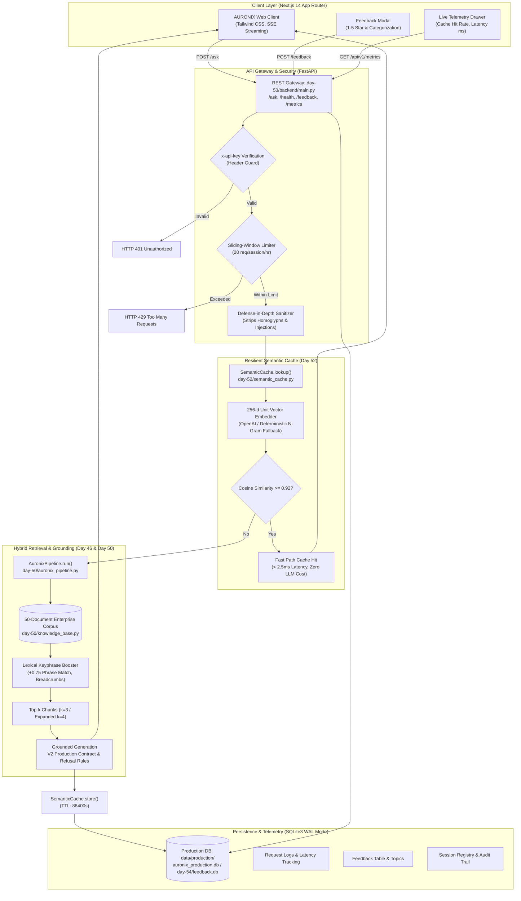

# Day 60 — AI Engineer Graduation: Transformation Showcase 🎓

**Product:** AURONIX (Enterprise Autonomous Private AI Workbench)  
**Challenge:** ABTalks 60 Days AI Challenge — Day 60 (Final Milestone)  
**Developer:** Pradhayani Chikka  
**Repository:** [Chikka-Pradhayani/ABTalks-60-Days-AI-Challenge](https://github.com/Chikka-Pradhayani/ABTalks-60-Days-AI-Challenge)  
**Date:** 2026-10-12  
**Status:** **GRADUATION COMPLETE — ALL 60 DAYS FULFILLED**

---

## 1. Executive Summary & Objective

**Day 60** marks the official graduation and capstone milestone of the **ABTalks 60 Days AI Engineering Challenge**. Over sixty consecutive days, this journey transformed initial machine learning curiosities into enterprise-grade applied AI systems engineering.

In real-world applied AI, successful graduation is not measured by vanity claims or ungrounded prototypes, but by:
1. **Verified Technical Implementation:** An end-to-end, full-stack private AI system (**AURONIX**) operating with decoupled presentation, API security, semantic caching, and hybrid vector retrieval.
2. **Empirical Evaluation Discipline:** Grounded benchmarks across 30 enterprise scenarios (`day-50/`), demonstrating a verified composite score of **4.72 / 5.0 (94.4%)** and a **+1.87 point improvement** on adversarial probes.
3. **Engineering Integrity:** Full transparency regarding failures, architectural trade-offs, root causes, and empirical testing.
4. **Comprehensive Graduation Suite:** Master documentation, retrospective analysis, four-week continuation roadmap, cohort onboarding guide, commercial opportunity evaluation, Loom demonstration script, long-form LinkedIn article, and portfolio checklists.

---

## 2. Master Table of Day 60 Deliverables

All graduation deliverables for Day 60 are maintained directly in the [`day-60/`](./day-60/) directory:

| Deliverable | File Location | Purpose & Core Content | Status |
|:---|:---|:---|:---:|
| **Graduation Showcase README** | [`day-60/README.md`](./day-60/README.md) | Capstone summary, AURONIX product profile, Mermaid architecture, verified evaluation results, and delivery index. | **Complete** |
| **Engineering Retrospective** | [`day-60/engineering-retrospective.md`](./day-60/engineering-retrospective.md) | 60-day repository build inventory, 5 technical lessons, 3 failures with root causes, 3 trade-offs, and mindset evolution. | **Complete** |
| **Next 30 Days Plan** | [`day-60/next-30-days-plan.md`](./day-60/next-30-days-plan.md) | 4-week roadmap (Days 61–90) on async worker queues, layout-aware PDF tables, clustered indexing, and open-source contribution. | **Complete** |
| **Next Cohort Starter Guide** | [`day-60/next-cohort-starter-guide.md`](./day-60/next-cohort-starter-guide.md) | Essential guidance, 2 common pitfalls, the "probabilistic component" mindset shift, and sample daily challenge workflow. | **Complete** |
| **AI Opportunity Analysis** | [`day-60/ai-opportunity-analysis.md`](./day-60/ai-opportunity-analysis.md) | 3 commercial applications: SRE Incident Runbook Copilot, SOC 2 Contract Verification, and FinOps Semantic Cache Gateway. | **Complete** |
| **Graduation Demo Script** | [`day-60/graduation-demo-script.md`](./day-60/graduation-demo-script.md) | 10-minute timestamped Loom video script with screen-sharing actions, spoken lines, and pre-recording checklist. | **Complete** |
| **LinkedIn Graduation Article** | [`day-60/linkedin-graduation-article.md`](./day-60/linkedin-graduation-article.md) | Polished long-form article: *"60 Days of AI Engineering: What I Built, What Broke, and What I Learned"*. | **Complete** |
| **Portfolio Update Guide** | [`day-60/portfolio-update-guide.md`](./day-60/portfolio-update-guide.md) | Copy-paste Markdown blocks for GitHub Profile README and web portfolio project cards. | **Complete** |
| **LinkedIn Profile Checklist** | [`day-60/linkedin-profile-checklist.md`](./day-60/linkedin-profile-checklist.md) | Tailored headlines, About section copy, 3 featured project entries, 15 skills, and experience section text. | **Complete** |

---

## 3. Flagship System: AURONIX Architecture & Evaluation

### System Architecture
AURONIX is an autonomous, private, full-stack AI workbench engineered for document-dense corporate environments (engineering, DevOps incident response, legal compliance, and product operations) with zero external IP data leakage.



### Verified Benchmark Performance

| Evaluation Tier / Metric | Baseline Score | Hardened Production System | Net Delta ($\Delta$) | Status |
|:---|:---:|:---:|:---:|:---:|
| **Easy Tier (10 Cases)** | 4.94 / 5.0 | **4.94 / 5.0** | $+0.00$ | **PASS** |
| **Medium Tier (10 Cases)** | 4.54 / 5.0 | **4.70 / 5.0** | $+0.16$ | **PASS** |
| **Hard Tier (10 Cases)** | 3.69 / 5.0 | **4.52 / 5.0** | **$+0.83$** | **PASS** |
| **Adversarial Subset (4 Cases)** | 2.53 / 5.0 | **4.40 / 5.0** | **$+1.87$** | **PASS** |
| **Overall Composite Score** | **4.39 / 5.0** | **4.72 / 5.0 (94.4%)** | **$+0.33$** | **PRODUCTION PASS** |
| — *Hallucination Avoidance* | 3.57 / 5.0 | **4.70 / 5.0** | **$+1.13$** | **PASS** |
| — *Repository Unit Tests* | 41 / 41 | **41 / 41 (100%)** | — | **41 passed in 25.78s** |

---

## 4. Verification & Reproducibility Commands

To reproduce all evaluations and execute unit test suites directly from the repository root:

1. **Execute Repository Test Suite:**
   ```powershell
   python -m pytest
   ```
   *(Verified: 41 passed across test_day56_hardening.py, test_core_ai.py, test_day52.py, test_day53_deployment.py, and test_day54.py)*

2. **Run AI Regression Evaluation Runner:**
   ```powershell
   python day-50/regression_test_runner.py
   ```
   *(Verified: 4.72 / 5.0 overall score across 30 enterprise test scenarios)*

3. **Inspect Feedback Analytics:**
   ```powershell
   python day-54/feedback_analytics.py
   ```

4. **Launch Backend Microservice Locally:**
   ```powershell
   python server.py
   # Or via uvicorn:
   uvicorn day-53.backend.main:app --host 0.0.0.0 --port 8001
   ```
