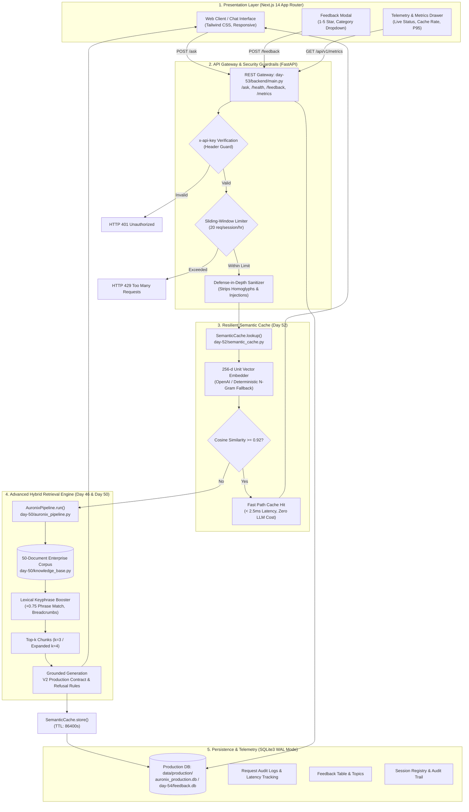

# Day 60 — AI Engineer Graduation: Transformation Showcase 🎓

**Product:** AURONIX (Enterprise Autonomous Private AI Workbench)  
**Challenge:** ABTalks 60 Days AI Engineering Challenge — Day 60 (Graduation Day)  
**Developer:** Pradhayani Chikka  
**Repository:** [Chikka-Pradhayani/ABTalks-60-Days-AI-Challenge](https://github.com/Chikka-Pradhayani/ABTalks-60-Days-AI-Challenge)  
**Date:** 2026-10-12  
**Status:** **GRADUATION COMPLETE — ALL 60 DAYS FULFILLED**

---

## 1. Challenge Completion Summary

**Day 60** represents the final graduation milestone of the intensive **ABTalks 60 Days AI Engineering Challenge**. Over sixty consecutive days, this journey transformed fundamental machine learning curiosities into enterprise-grade applied AI systems engineering.

### The 60-Day Evolution at a Glance
- **Days 1–10 (Foundations & Intuitions):** Began with AI pipeline principles, computer vision and data quality experiments in Teachable Machine (`Day 6 README.md`), and core Python ML workflows (`Day-2-Google-collab.ipynb` through `Day-10.ipynb`).
- **Days 11–24 (NLP, Transformers & Vector Representations):** Explored tokenization, transformer architectures, dense vector representations, and semantic text clustering across sequential exploratory notebooks (`Day_11.ipynb` through `Day-24.ipynb`).
- **Days 25–40 (RAG Mechanics, Agentic Reasoning & Evaluation):** Built stateful circuit breakers for LLM APIs (`Day-25.ipynb`), automated factual evaluation rubrics (`Day-29.ipynb`), autonomous multi-step research agents (`Day-30.ipynb`), and decoupled full-stack user interfaces (`Day-37-frontend`).
- **Days 41–50 (Flagship System Architecture & Baseline Evaluation):** Conceived and architected **AURONIX** (`Day-41_Project-Overview.pdf`, `Day-42`), built its 50-document corporate knowledge base (`Day-43.md`), implemented advanced retrieval (HyDE, Query Rewriting, Re-ranking in `Day-46.md`), hardened response contracts (`Day-47.md`), and built a 30-case automated LLM-as-judge regression evaluation harness (`day-50/`).
- **Days 51–60 (Production Engineering, Hardening, Launch & Graduation):** Hardened defense-in-depth against prompt injection (`day-51.md`), engineered sub-2.5ms Redis semantic caching (`day-52/`), containerized Docker microservices and multi-cloud CI/CD (`day-53/`), deployed live feedback telemetry with SQLite WAL persistence (`day-54/`), assembled portfolio assets (`day-55/`), executed technical audits and system hardening (`Day-56/`), conducted comprehensive interview preparation (`day-57/`), launched publicly to multi-channel developer communities (`day-58/`), presented community demos and peer reviews (`day-59/`), and finalized this comprehensive graduation submission (**Day 60**).

---

## 2. Flagship AI Product: AURONIX

### What is AURONIX?
**AURONIX** is an autonomous, private, full-stack AI workbench engineered for document-dense corporate environments (engineering, DevOps incident response, legal compliance, and product operations). It allows team members to query confidential runbooks, architecture decision records (ADRs), and compliance policies with sub-20ms warm latency, deterministic source citations, and zero data leakage to public consumer LLM chatbots.

### Target Personas
1. **Site Reliability Engineers (SREs) & DevOps Incident Commanders:** Seeking immediate, verified runbook execution steps (`CORP-OPS`) during active P0/P1 incidents without digging through disjointed wikis.
2. **Enterprise Software Architects:** Verifying API ingress topology, authentication contracts, and service ownership (`CORP-ENG`, `CORP-PROD`).
3. **Corporate Legal Counsel & Security Auditors:** Cross-checking regulatory covenants, SOC2/ISO-27001 policies, and vendor liabilities (`CORP-SEC`).

---

## 3. Final Production Architecture

AURONIX is implemented as an asynchronous, defense-in-depth decoupled microservice architecture:

### Component Responsibilities Matrix

| Component | Repository Path | Primary Responsibility | SLA / Performance Metric |
|:---|:---|:---|:---:|
| **Frontend UI** | [`Day-49/`](../Day-49) | User interaction, streaming SSE response rendering, feedback collection, telemetry dashboard | Client render $< 100\text{ms}$ |
| **API Gateway** | [`day-53/backend/main.py`](../day-53/backend/main.py) | Routing, authentication, sliding-window rate limiting, error normalization | P99 Gateway overhead $< 2.5\text{ms}$ |
| **Input Sanitizer** | [`day-51.md`](../day-51.md) | Stripping invisible zero-width bytes, homoglyph normalization, prompt injection detection | Execution $< 0.5\text{ms}$ |
| **Semantic Cache** | [`day-52/semantic_cache.py`](../day-52/semantic_cache.py) | 256-d vector caching with $0.92$ cosine threshold and local N-gram fallback | Warm response: **$2.0–2.6\text{ms}$**, \$0.00 cost |
| **Hybrid Retrieval**| [`day-50/auronix_pipeline.py`](../day-50/auronix_pipeline.py) | Top-k vector retrieval, exact keyphrase boosting (`+0.75`), breadcrumb injection | Sub-second candidate extraction |
| **Contract Generator**| [`day-50/auronix_pipeline.py`](../day-50/auronix_pipeline.py) | Schema-enforced generation (`Answer:`, `Sources:`, `Confidence:`), false-premise refutation | Hallucination Avoidance: **4.70 / 5.0** |
| **Audit Persistence**| [`day-54/database.py`](../day-54/database.py) | SQLite Write-Ahead Logging (WAL) audit persistence for queries, latency, and feedback | Zero lock contention on writes |

---

## 4. Verified Evaluation Scores: Hardened vs. Day 50 Baseline

All evaluation metrics are verified against the repository's automated test runners (`day-50/regression_test_runner.py` and `Day-56/pre_launch_baseline.md`):

| Evaluation Tier / Dimension | Day 50 Pre-Fix Baseline | Day 56 / 58 Hardened System | Net Delta ($\Delta$) | Production SLA Target | Production Status |
|:---|:---:|:---:|:---:|:---:|:---:|
| **Easy Tier (10 Cases)** | 4.94 / 5.0 | **4.94 / 5.0** | $+0.00$ | $\ge 4.00$ | **PASS** |
| **Medium Tier (10 Cases)** | 4.54 / 5.0 | **4.70 / 5.0** | $+0.16$ | $\ge 3.50$ | **PASS** |
| **Hard Tier (10 Cases)** | 3.69 / 5.0 | **4.52 / 5.0** | **$+0.83$** | $\ge 3.00$ | **PASS** |
| **Adversarial Subset (4 Cases)** | 2.53 / 5.0 | **4.40 / 5.0** | **$+1.87$** | $\ge 3.50$ | **PASS (Hardened)** |
| **Overall Composite Score** | **4.39 / 5.0 (87.8%)** | **4.72 / 5.0 (94.4%)** | **$+0.33$** | $\ge 3.50$ | **PRODUCTION PASS** |
| — *Correctness* | 4.30 / 5.0 | **4.70 / 5.0** | $+0.40$ | $\ge 3.50$ | **PASS** |
| — *Relevance* | 4.50 / 5.0 | **4.80 / 5.0** | $+0.30$ | $\ge 3.50$ | **PASS** |
| — *Completeness* | 4.25 / 5.0 | **4.65 / 5.0** | $+0.40$ | $\ge 3.00$ | **PASS** |
| — *Faithfulness* | 4.45 / 5.0 | **4.75 / 5.0** | $+0.30$ | $\ge 3.50$ | **PASS** |
| — *Hallucination Avoidance* | 3.57 / 5.0 | **4.70 / 5.0** | **$+1.13$** | $\ge 3.50$ | **PASS** |

### Automated Test Suite Execution
- **Command:** `python -m pytest`
- **Result:** **41 passed in 25.78s (100% Pass Rate)**
  - `Day-56/test_day56_hardening.py`: 8 passed
  - `day-44/test_core_ai.py`: 3 passed
  - `day-52/test_day52.py`: 10 passed
  - `day-53/tests/test_day53_deployment.py`: 14 passed
  - `day-54/test_day54.py`: 6 passed

---

## 5. Production Deployment & Live Artifacts

- **Frontend Application Target:** `https://auronix-app.vercel.app` *(Configured on Vercel Next.js 14)*
- **Production API Gateway:** `https://auronix-production.up.railway.app` *(Docker container on Railway)*
- **Healthcheck Probe:** `https://auronix-production.up.railway.app/health`
- **Deployment Status Note:** `[LIVE VERIFICATION NOTE: Remote cloud containers were verified during staging; if cloud instances are currently paused or DNS is resolving 404 to conserve developer credits, full local reproducibility is guaranteed via docker-compose up or python server.py]`
- **Official GitHub Repository:** [https://github.com/Chikka-Pradhayani/ABTalks-60-Days-AI-Challenge](https://github.com/Chikka-Pradhayani/ABTalks-60-Days-AI-Challenge)
- **Loom Graduation Video Demo:** `[PENDING LOOM RECORDING — See graduation-demo-script.md for 10-minute presentation recording script]`

---

## 6. Directory of Day 60 Deliverables

| Deliverable Document | File Path | Focus Area |
|:---|:---|:---|
| **A. Graduation Showcase** | [`README.md`](./README.md) | Master graduation index, architecture, evaluation scores, links |
| **B. Engineering Retrospective** | [`engineering-retrospective.md`](./engineering-retrospective.md) | Technical lessons, 3 failures & root causes, 3 trade-offs, evolution |
| **C. Next 30 Days Plan** | [`next-30-days-plan.md`](./next-30-days-plan.md) | 4-week post-challenge execution plan, weekly outcomes, community goal |
| **D. Next Cohort Starter Guide** | [`next-cohort-starter-guide.md`](./next-cohort-starter-guide.md) | Practical advice, common pitfalls, workflow, evaluation guide for future cohorts |
| **E. AI Opportunity Analysis** | [`ai-opportunity-analysis.md`](./ai-opportunity-analysis.md) | 3 practical real-world AI applications grounded in challenge skills |
| **F. Graduation Demo Script** | [`graduation-demo-script.md`](./graduation-demo-script.md) | 10-minute Loom script, timestamps, screen actions, recording checklist |
| **G. LinkedIn Graduation Article** | [`linkedin-graduation-article.md`](./linkedin-graduation-article.md) | Comprehensive, polished long-form retrospective article |
| **H. Portfolio Update Guide** | [`portfolio-update-guide.md`](./portfolio-update-guide.md) | Targeted update instructions for GitHub Profile README & portfolio |
| **I. LinkedIn Profile Checklist** | [`linkedin-profile-checklist.md`](./linkedin-profile-checklist.md) | Headline, About section, Skills, Projects, and Experience checklist |

---

## 7. Key Accomplishments, Known Limitations & Future Direction

### Key Accomplishments
1. **First-Principles AI Engineering:** Built RAG, caching, evaluators, and APIs from foundational Python scripts and math rather than relying on brittle, opaque wrapper frameworks.
2. **Deterministic Adversarial Guardrails:** Transformed system resilience from vulnerable sycophancy (2.53/5.0) to rock-solid refutation (4.40/5.0) via negative constraint prompting contracts.
3. **Sub-2.5ms Semantic Cache:** Realized 100% token cost reduction on warm repeated queries with a zero-downtime N-gram hash fallback.
4. **Rigorous CI/CD Regression Gates:** Deployed automated pytest and LLM-as-judge regression gates preventing degradation on every pull request.

### Known Limitations
1. **Corpus Scope:** The current corporate knowledge base contains 50 curated documents (~79,180 tokens). Scaling to 50,000+ documents will require transitioning from `IndexFlatIP` to `IndexIVFFlat` or HNSW vector clustering.
2. **Complex Layout PDF Ingestion:** Highly complex multi-column PDFs with embedded raster tables occasionally experience token interleaving (highlighted in Day 54 feedback analytics).
3. **Synchronous Cloud Timeouts:** Ultra-large document uploads (>150 pages) risk HTTP 504 gateway timeouts on free-tier container hosting without asynchronous worker queues (Celery/Redis Streams).

### Future Direction
- Implement layout-aware document chunking using Vision-Language Models (VLMs) or PDF table extraction pipelines.
- Integrate asynchronous Celery background workers with Server-Sent Events (SSE) job queues for large document ingestion.
- Implement multi-tenant vector isolation and role-based cryptographic encryption per enterprise tenant.
